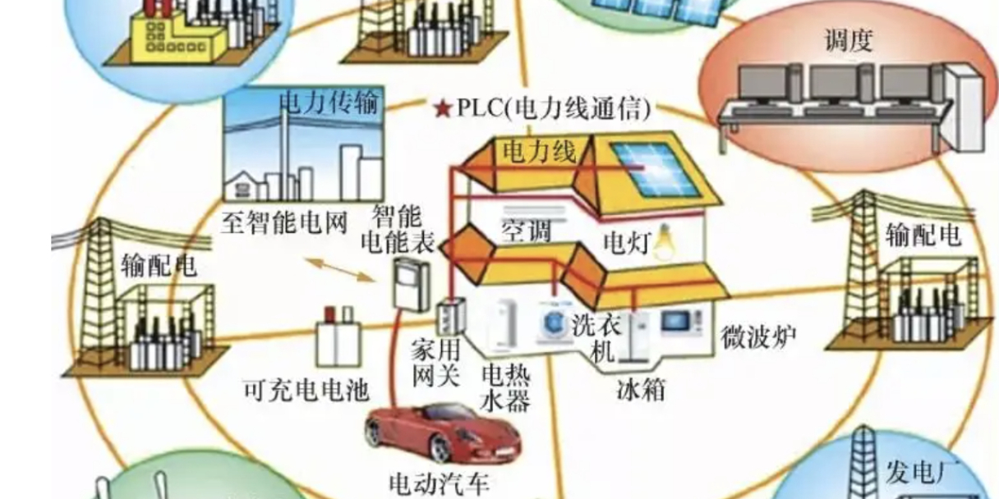

# Microgrid Dispatch (Wind, Solar, Energy Storage, Grid) (Matlab Code Implementation)

Microgrid Dispatching (Wind, Solar Power, Energy Storage, Grid) (Matlab Code Implementation)
The following is only a part of the code:
clear;\n\n\n% define named indices into bus, branch matrices\n[PQ, PV, REF, NONE, BUS_I, BUS_TYPE, PD, QD, GS, BS, BUS_AREA, VM, ...\n    VA, BASE_KV, ZONE, VMAX, VMIN, LAM_P, LAM_Q, MU_VMAX, MU_VMIN] = indexBus;\n\n\n[F_BUS, T_BUS, BR_R, BR_X, BR_B, RATE_A, RATE_B, ...\n    RATE_C, TAP, SHIFT, BR_STATUS, PF, QF, PT, QT, MU_SF, MU_ST, ...\n    ANGMIN, ANGMAX, MU_ANGMIN, MU_ANGMAX] = indexBrch;\n\n\n[GEN_BUS, PG, QG, QMAX, QMIN, VG, MBASE, GEN_STATUS, PMAX, PMIN, ...\n    MU_PMAX, MU_PMIN, MU_QMAX, MU_QMIN, PC1, PC2, QC1MIN, QC1MAX, ...\n    QC2MIN, QC2MAX, RAMP_AGC, RAMP_10, RAMP_30, RAMP_Q, APF] = indexGen;\n\n\n%network\ndata=loadcase('case24_ieee_rts');\n\n\nbaseMVA=data.baseMVA;\nbus=data.bus;\nbranch=data.branch;\ngen=data.gen;\n\n\nnb = size(bus, 1);          %% number of buses\nnl = size(branch, 1);       %% number of lines\n\n\n[ Bbus, Bf,Bft, Pbusinj, Pfinj ] = calBdc( baseMVA, bus, branch );\n\n\n% generator info\n% on = find(gen(:, GEN_STATUS) > 0);      %% which generators are on?\n% Here, modify the number of generators\n% on = [1;2;3;4];\n% gbus = gen(on, GEN_BUS);                %% what buses are they at?\ngbus=[1;1;2;2;7;13;15;18;21;22];\n\n\n% form net complex bus power injection vector\nnb = size(bus, 1);\nngon = size(gbus, 1);\nCg = sparse(gbus, (1:ngon)', ones(ngon, 1), nb, ngon);  %% connection matrix of generation\n\n\ndsbus=[18];\nnds=size(dsbus,1);\nCds=sparse(dsbus, (1:nds)', ones(nds, 1), nb, nds);  %% connection matrix of ds\n\n\ndcbus=[1;2;8;14;19;20];\nndc=size(dcbus,1);\nCdc=sparse(dcbus, (1:ndc)', ones(ndc, 1), nb, ndc);  %% connection matrix of ds\n\n\nT=24;\n\n\n% Microgrid parameters\ndsmax_base=[0.221]/baseMVA;\nLoadcoe=[0.45,0.45,0.5,0.55,0.6,0.65,0.7,0.8,0.9,1.1,1.5,1.6,1.2,1.1,1,0.9,0.8,0.85,1,1.5,1.55,1.1,0.8,0.7];\n%Loadcoe=[1];\n\n\ndsmax=zeros(nds,T);\nfor t=1:T\n    dsmax(:,t)=dsmax_base*Loadcoe(t);\nend\n\n\n% Scene count\nWcoe=[1.4,1.4,1.3,1.2,1.1,1,0.8,0.7,0.6,0.55,0.5,0.45,0.4,0.5,0.6,0.7,0.8,0.9,1,1.1,1.2,1.3,1.35,1.4];\n%Wcoe=[1];\n\n\nK=5;\nWact_base=[0.02,0.04,0.09,0.12,0.18]/baseMVA;\nphi=[0.1;0.2;0.4;0.2;0.1];\n\n\nWact=zeros(T,K);\nfor t=1:T\n    Wact(t,:)=Wact_base*Wcoe(t);\nend\n\n\n\n\nPDGmax=[0.2]/baseMVA;\nRdgumax=0.1*PDGmax;\nRdgdmax=Rdgumax;\nWmax=0.23/baseMVA;\nUs=[26];\nODG=[13];\n\n\n\n\n\n\n% Connection line\nPTLmax=0.2/baseMVA;\n\n\n\n\nPgmax=[40;152;40;152;300;591;60;400;400;300]/baseMVA;\ndc_base=[110.16;98.94;174.42;197.88;184.62;130.56]/baseMVA;\n\n\ndc=zeros(ndc,T);\n\n\nfor t=1:T\n    dc(:,t)=dc_base*Loadcoe(t);\nend\n\n\nBaseG=[1;2;3;4;5;6;8;9];\nPearkG=[7;10];\n\n\nRgumax=zeros(ngon,1);\nRgumax(BaseG)=0*Pgmax(BaseG);\nRgumax(PearkG)=0.2*Pgmax(PearkG);\nRgdmax=Rgumax;\n\n\ncoe=1;\nRds=[1];\nRdsumax=zeros(nds,1);\nRdsumax(Rds)=0.1*dsmax(Rds)*coe;\nRdsdmax=Rdsumax;\n\n\n\n\n%cost\nOg=[21;18.57;21;13.58;22;18.57;24.57;13.58;10.46;10.46];\n\n\nUc=[23.5;20;25;21;22.3;22];\n\n\nVc=1000*ones(ndc,1);\n\n\npi_=pi*ones(nb,1);\n\n\nBdsmax=30;\n\n\n\n\nM=1e3;\n\n\n%variables\n%UL problem\nBds=sdpvar(nds,1,T,'full');\nPDG=sdpvar(nds,1,T,'full');\nds=sdpvar(nds,1,T,'full');\n\n\nrdsk=sdpvar(nds,K,T,'full');\nrdgk=sdpvar(nds,K,T,'full');\nw=sdpvar(nds,1,T,'full');\nwpk=sdpvar(nds,K,T,'full');\n\n\n%LL Problem\n%variables\nPg=sdpvar(ngon,1,T,'full');\nrgk=sdpvar(ngon,K,T,'full');\n\n\ndsn=sdpvar(nds,1,T,'full');\ndsnk=sdpvar(nds,K,T,'full');\n\n\ntheta=sdpvar(nb,1,T,'full');\nthetak=sdpvar(nb,K,T,'full');\n\n\n%dual variables\n%h1\nlamda=sdpvar(nb,1,T,'full');\n%h2\nlamdak=sdpvar(nb,K,T,'full');\n\n\n%g1\nUg_down=sdpvar(ngon,1,T,'full');\n%g2\nUg_up=sdpvar(ngon,1,T,'full');\n\n\n%g3\nUrgk1_down=sdpvar(ngon,K,T,'full');\n%g4\nUrgk1_up=sdpvar(ngon,K,T,'full');\n\n\n%g5\nUrgk2_down=sdpvar(ngon,K,T,'full');\n%g6\nUrgk2_up=sdpvar(ngon,K,T,'full');\n\n\n%g7\nUdsn_down=sdpvar(nds,1,T,'full');\n%g8\nUdsn_up=sdpvar(nds,1,T,'full');\n\n\n%g9\nUdsnk1_down=sdpvar(nds,K,T,'full');\n%g10\nUdsnk1_up=sdpvar(nds,K,T,'full');\n\n\n%g11\nUdsnk2_down=sdpvar(nds,K,T,'full');\n%g12\nUdsnk2_up=sdpvar(nds,K,T,'full');\n\n\n\n\n%g29\nUtheta_down=sdpvar(nb,1,T,'full');\n%g30\nUtheta_up=sdpvar(nb,1,T,'full');\n%g31\nUthetak_down=sdpvar(nb,K,T,'full');\n%g32\nUthetak_up=sdpvar(nb,K,T,'full');\n\n\n\n\n%bin variables\n%g1\nbinUg_down=binvar(ngon,1,T,'full');\n%g2\nbinUg_up=binvar(ngon,1,T,'full');\n\n\n%g3\nbinUrgk1_down=binvar(ngon,K,T,'full');\n%g4\nbinUrgk1_up=binvar(ngon,K,T,'full');\n\n\n%g5\nbinUrgk2_down=binvar(ngon,K,T,'full');\n%g6\nbinUrgk2_up=binvar(ngon,K,T,'full');\n\n\n%g7\nbinUdsn_down=binvar(nds,1,T,'full');\n%g8\nbinUdsn_up=binvar(nds,1,T,'full');\n\n\n%g9\nbinUdsnk1_down=binvar(nds,K,T,'full');\n%g10\nbinUdsnk1_up=binvar(nds,K,T,'full');\n\n\n%g11\nbinUdsnk2_down=binvar(nds,K,T,'full');\n%g12\nbinUdsnk2_up=binvar(nds,K,T,'full');\n\n\n\n\n%g29\nbinUtheta_down=binvar(nb,1,T,'full');\n%g30\nbinUtheta_up=binvar(nb,1,T,'full');\n%g31\nbinUthetak_down=binvar(nb,K,T,'full');\n%g32\nbinUthetak_up=binvar(nb,K,T,'full');\n\n\nConstraints=[];\nfor t=1:T\n%UL Constraints\nConstraints=[Constraints,0<=Bds(:,:,t)<=Bdsmax];\n% Constraints=[Constraints,Bds(:,:,t)==Us];\nConstraints=[Constraints,0<=PDG(:,:,t)<=PDGmax];\nConstraints=[Constraints,0<=ds(:,:,t)<=dsmax(:,t)];\nConstraints=[Constraints,0<=w(:,:,t)<=Wmax];\nConstraints=[Constraints,0<=wpk(:,:,t)<=w(:,:,t)];\n\n\n% Microgrid power balance\nConstraints=[Constraints,(dsn(:,:,t)+PDG(:,:,t)+w(:,:,t)-ds(:,:,t))==0];\nfor k=1:K\nConstraints=[Constraints,(rdgk(:,k,t)+rdsk(:,k,t)-dsnk(:,k,t)+(Wact(t,k)-w(:,:,t)-wpk(:,k,t)))==0];\nConstraints=[Constraints,-(dsmax(:,t)-ds(:,:,t))<=rdsk(:,k,t)<=ds(:,:,t)];\nConstraints=[Constraints,-PDG(:,:,t)<=rdgk(:,k,t)<=(PDGmax-PDG(:,:,t))];\nConstraints=[Constraints,-Rdgdmax<=rdgk(:,k,t)<=Rdgumax];\nend\n\n\n%LL Constraints\n%KKT Pg\nConstraints=[Constraints,(Og - Cg'*lamda(:,:,t) - Ug_down(:,:,t) + Ug_up(:,:,t) - sum(Urgk1_down(:,:,t),2) +  sum(Urgk1_up(:,:,t),2)) == 0];\n%KKT rgk\nfor k=1:K\n    Constraints=[Constraints,(phi(k)*Og - Cg'*lamdak(:,k,t) - Urgk1_down(:,k,t) + Urgk1_up(:,k,t) - Urgk2_down(:,k,t) + Urgk2_up(:,k,t)) == 0];\nend\n\n\n%KKT dsn\nConstraints=[Constraints,(-Bds(:,:,t) + Cds'*lamda(:,:,t) - Udsn_down(:,:,t) + Udsn_up(:,:,t) + sum(Udsnk1_down(:,:,t),2) - sum(Udsnk1_up(:,:,t),2)) == 0];\n%KKT dsnk\nfor k=1:K\n    Constraints=[Constraints,(phi(k)*Bds(:,:,t) - Cds'*lamdak(:,k,t) - Udsnk1_down(:,k,t) + Udsnk1_up(:,k,t) -Udsnk2_down(:,k,t) + Udsnk2_up(:,k,t)) == 0];\nend\n\n\n\n\n%KKT theta\nConstraints=[Constraints,(Bbus'*lamda(:,:,t) - sum(Bbus'*lamdak(:,:,t),2) - Utheta_down(:,:,t) + Utheta_up(:,:,t))==0];\n%KKT thetak\nfor k=1:K\n    Constraints=[Constraints,(Bbus'*lamdak(:,k,t) - Uthetak_down(:,k,t) + Uthetak_up(:,k,t)) == 0];\nend\n\n\n%h1\nConstraints=[Constraints,(Cg*Pg(:,:,t) - Cds*dsn(:,:,t) - Cdc*dc(:,t) - Bbus*theta(:,:,t)) ==0];\n\n\nfor k=1:K\n    %h2\n    Constraints=[Constraints,(Cg*rgk(:,k,t) + Cds*dsnk(:,k,t) - Bbus*(thetak(:,k,t)-theta(:,:,t)))==0];\nend\n%g1\nConstraints=[Constraints,Pg(:,:,t)>=0, Ug_down(:,:,t)>=0, Pg(:,:,t)<=binUg_down(:,:,t)*M , Ug_down(:,:,t)<=(1-binUg_down(:,:,t))*M ];\n%g2\nConstraints=[Constraints,(Pgmax-Pg(:,:,t))>=0, Ug_up(:,:,t)>=0, (Pgmax-Pg(:,:,t))<=binUg_up(:,:,t)*M , Ug_up(:,:,t)<=(1-binUg_up(:,:,t))*M ];\n\n\nfor k=1:K\n    %g3\n    Constraints=[Constraints,(rgk(:,k,t)+Pg(:,:,t))>=0,Urgk1_down(:,k,t)>=0,(rgk(:,k,t)+Pg(:,:,t))<=binUrgk1_down(:,k,t)*M ,Urgk1_down(:,k,t)<=(1-binUrgk1_down(:,k,t))*M ];\n    %g4\n    Constraints=[Constraints,(Pgmax-Pg(:,:,t)-rgk(:,k,t))>=0,Urgk1_up(:,k,t)>=0,(Pgmax-Pg(:,:,t)-rgk(:,k,t))<=binUrgk1_up(:,k,t)*M ,Urgk1_up(:,k,t)<=(1-binUrgk1_up(:,k,t))*M ];\n    %g5\n    Constraints=[Constraints,(rgk(:,k,t)+Rgdmax)>=0,Urgk2_down(:,k,t)>=0,(rgk(:,k,t)+Rgdmax)<=binUrgk2_down(:,k,t)*M ,Urgk2_down(:,k,t)<=(1-binUrgk2_down(:,k,t))*M ];\n    %g6\n    Constraints=[Constraints,(Rgumax-rgk(:,k,t))>=0,Urgk2_up(:,k,t)>=0,(Rgumax-rgk(:,k,t))<=binUrgk2_up(:,k,t)*M ,Urgk2_up(:,k,t)<=(1-binUrgk2_up(:,k,t))*M ];\nend\n\n\n%g7\nConstraints=[Constraints,(dsn(:,:,t)+PTLmax)>=0,Udsn_down(:,:,t)>=0,(dsn(:,:,t)+PTLmax)<=binUdsn_down(:,:,t)*M ,Udsn_down(:,:,t)<=(1-binUdsn_down(:,:,t))*M ];\n%g8\nConstraints=[Constraints,(PTLmax-dsn(:,:,t))>=0,Udsn_up(:,:,t)>=0,(PTLmax-dsn(:,:,t))<=binUdsn_up(:,:,t)*M ,Udsn_up(:,:,t)<=(1-binUdsn_up(:,:,t))*M ];\n\n\nfor k=1:K\n    %g9\n    Constraints=[Constraints,(dsnk(:,k,t)+PTLmax-dsn(:,:,t))>=0,Udsnk1_down(:,k,t)>=0,(dsnk(:,k,t)+PTLmax-dsn(:,:,t))<=binUdsnk1_down(:,k,t)*M ,Udsnk1_down(:,k,t)<=(1-binUdsnk1_down(:,k,t))*M ];\n    %g10\n    Constraints=[Constraints,(dsn(:,:,t)+PTLmax-dsnk(:,k,t))>=0,Udsnk1_up(:,k,t)>=0,(dsn(:,:,t)+PTLmax-dsnk(:,k,t))<=binUdsnk1_up(:,k,t)*M ,Udsnk1_up(:,k,t)<=(1-binUdsnk1_up(:,k,t))*M ];\n    %g11\n    Constraints=[Constraints,(dsnk(:,k,t)+Rdsdmax)>=0,Udsnk2_down(:,k,t)>=0,(dsnk(:,k,t)+Rdsdmax)<=binUdsnk2_down(:,k,t)*M ,Udsnk2_down(:,k,t)<=(1-binUdsnk2_down(:,k,t))*M ];\n    %g12\n    Constraints=[Constraints,(Rdsumax-dsnk(:,k,t))>=0,Udsnk2_up(:,k,t)>=0,(Rdsumax-dsnk(:,k,t))<=binUdsnk2_up(:,k,t)*M ,Udsnk2_up(:,k,t)<=(1-binUdsnk2_up(:,k,t))*M ];\nend\n\n\n%g29\nConstraints=[Constraints,(theta(:,:,t)+pi)>=0,Utheta_down(:,:,t)>=0,(theta(:,:,t)+pi)<=binUtheta_down(:,:,t)*M ,Utheta_down(:,:,t)<=(1-binUtheta_down(:,:,t))*M ];\n%g30\nConstraints=[Constraints,(pi-theta(:,:,t))>=0,Utheta_up(:,:,t)>=0,(pi-theta(:,:,t))<=binUtheta_up(:,:,t)*M ,Utheta_up(:,:,t)<=(1-binUtheta_up(:,:,t))*M ];\nfor k=1:K\n    %g31\n    Constraints=[Constraints,(thetak(:,k,t)+pi)>=0,Uthetak_down(:,k,t)>=0,(thetak(:,k,t)+pi)<=binUthetak_down(:,k,t)*M ,Uthetak_down(:,k,t)<=(1-binUthetak_down(:,k,t))*M ];\n    %g32\n    Constraints=[Constraints,(pi-thetak(:,k,t))>=0,Uthetak_up(:,k,t)>=0,(pi-thetak(:,k,t))<=binUthetak_up(:,k,t)*M ,Uthetak_up(:,k,t)<=(1-binUthetak_up(:,k,t))*M ];\nend\n\n\n\n\n%ref bus\nConstraints=[Constraints,theta(1,:,t)==0];\nfor k=1:K\n    Constraints=[Constraints,thetak(1,k,t)==0];\nend\n\n\nend\n\n\n\n\nObjective=0;\n\n\nfor t=1:T\n    Objective = Objective - (lamda(:,:,t)'*Cdc*dc(:,t)...\n        -Ug_up(:,:,t)'*Pgmax - sum(Urgk1_up(:,:,t)'*Pgmax) - sum(Urgk2_down(:,:,t)'*Rgdmax) - sum(Urgk2_up(:,:,t)'*Rgumax)...\n        -Utheta_down(:,:,t)'*pi_ - Utheta_up(:,:,t)'*pi_ - sum(Uthetak_down(:,:,t)'*pi_) - sum(Uthetak_up(:,:,t)'*pi_)...\n        - Og'*Pg(:,:,t) -( Og'*rgk(:,:,t))*phi...\n        + Us*ds(:,:,t) - ODG*PDG(:,:,t) - (Us*rdsk(:,:,t) + ODG*rdgk(:,:,t))*phi);\nend\n\n\nops = sdpsettings('solver','gurobi','verbose',2);\noptimize(Constraints,Objective,ops);\n\n\nprofit=zeros(1,T);\n\n\nfor t=1:T\n    profit(t) = double(Us*ds(:,:,t)-lamda(:,:,t)'*Cds*dsn(:,:,t)-ODG*PDG(:,:,t)-Us*rdsk(:,:,t)*phi+sum(diag(lamdak(:,:,t)'*Cds*dsnk(:,:,t))) - ODG*rdgk(:,:,t)*phi);\nend\n\n\n% t=19;\n% p19=double(lamda(:,:,t)'*Cdc*dc(:,t)...\n%         -Ug_up(:,:,t)'*Pgmax - sum(Urgk1_up(:,:,t)'*Pgmax) - sum(Urgk2_down(:,:,t)'*Rgdmax) - sum(Urgk2_up(:,:,t)'*Rgumax)...\n%         -Utheta_down(:,:,t)'*pi_ - Utheta_up(:,:,t)'*pi_ - sum(Uthetak_down(:,:,t)'*pi_) - sum(Uthetak_up(:,:,t)'*pi_)...\n%         - Og'*Pg(:,:,t) -( Og'*rgk(:,:,t))*phi...\n%         + Us*ds(:,:,t) - ODG*PDG(:,:,t) - (Us*rdsk(:,:,t) + ODG*rdgk(:,:,t))*phi)\n\n\nBds=reshape(double(Bds),nds,T);\npriceDA=reshape(double(lamda),nb,T);\nPg=reshape(double(Pg),ngon,T);\ndsn=reshape(double(dsn),nds,T);\nds=reshape(double(ds),nds,T);\nw=reshape(double(w),nds,T);\nPDG=reshape(double(PDG),nds,T);\n\n\n  

## Images

<!-- PAYMENT_BLOCK -->

## Get this dataset

- Payment link (Stripe): [Buy now](https://buy.stripe.com/3cs8yP7sY87d0vu9AB)
- Payment QR code: 

<!-- /PAYMENT_BLOCK -->
